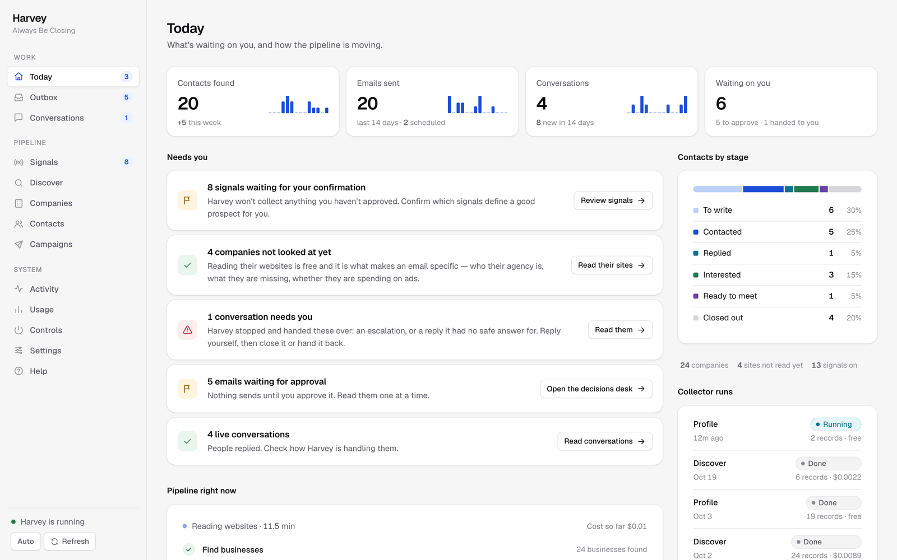
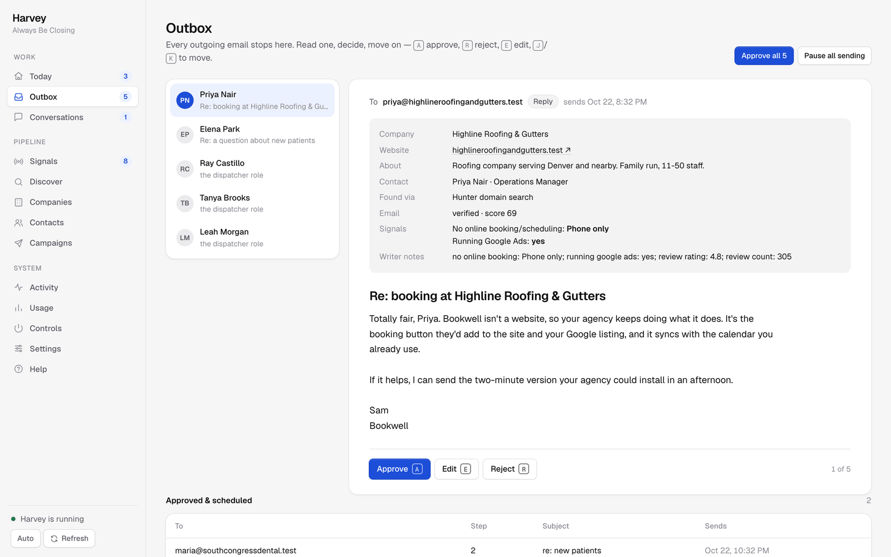
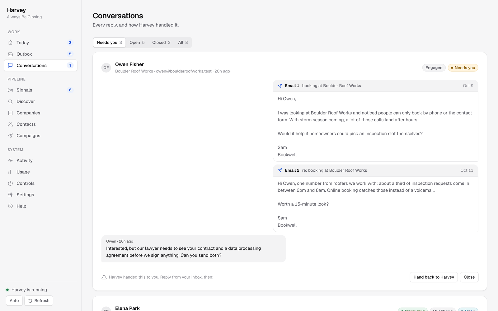

# The dashboard and the data

## The dashboard

```bash
sellbird dashboard     # prints the link to open, e.g. http://127.0.0.1:5555/#token=…
```

**Opening it.** The dashboard can change your mail settings, approve the outbox and start Sellbird, so it is locked to you, not just to your machine. On first start it creates a random token in `data/dashboard-token` (readable only by you) and prints a link carrying it after the `#`. Open that link: the page keeps the token for that browser tab only and removes it from the address bar. A new tab, or a tab opened without the link, shows a locked screen; paste the token there, or run `sellbird dashboard --url` to print the link again. Every API request needs the token as an `Authorization: Bearer` header — scripts and `curl` included — and the token is never accepted from a cookie or a query string. Delete `data/dashboard-token` and restart the dashboard to replace it.

**It only listens on this machine.** `--host` accepts loopback addresses only (`127.0.0.1`, `::1`, `localhost`), and requests must name one of them in their `Host` header, which also stops a DNS name pointed at 127.0.0.1 from reaching it. Requests sent by other websites open in your browser are refused. To use it from another computer, tunnel instead of exposing it: `ssh -L 5555:127.0.0.1:5555 your-machine`, then open the printed link locally. The token protects against other users and other websites, not against programs already running as your own user account, which can read the token file just as they can read `.env` or the database.

**Windows:** the token file is protected by the permissions of the folder it lives in (your user profile normally restricts this to you); Sellbird doesn't apply POSIX file modes there.

Plain HTML, CSS and JavaScript served from `sellbird/web/`. No build step, no framework, no bundler — edit `app.css` and reload. Fonts are vendored, so it renders correctly with the network off.

<picture>
  <source media="(prefers-color-scheme: dark)" srcset="screenshots/today-dark.png">
  
</picture>

The sidebar is grouped by what you're doing: **Work** (what needs you), **Pipeline** (what Sellbird is building) and **System** (how it's running). Counts next to a tab mean something is waiting there.

**Work**
- **Today** — four headline figures with 14-day trends (contacts found, emails sent, conversations, waiting on you), then everything that needs a decision, contacts by stage, collector runs and what the pipeline is doing right now. Setup shows here until it's finished, then disappears.
- **Outbox** — the decisions desk. Each email sits next to what Sellbird knew when it wrote it: the company, how the address was found and verified, and the signals the email draws on. `J`/`K` to move, `A` approve, `E` edit, `R` reject.
- **Conversations** — every reply in the context of the emails that led to it. Threads Sellbird handed to you (a contract request, a reply it had no safe answer for) come first, with **Hand back to Sellbird**, **Close** and **Reopen**.

**Pipeline**
- **Signals** — the confirmation gate and the cohort builder
- **Apollo** — where contacts come from: the segments Apollo is asked about, what the record has spent, every run it has ever made, and a free people search. The search withholds addresses, so its results are staged on Imports rather than bought. Every contact, every credit and every person already spoken for is kept in the database on the data volume, not in `exports/`, so a redeploy keeps all of it; the two CSVs in `exports/` are written from it after each run, and **Check the record** rebuilds them if they ever go missing. (Upstream Sellbird's local-business Discover sources live on in `sellbird discover`; a fork sourcing from Apollo has no use for the tab.)
- **Imports** — a list that arrived from outside, before it costs anything. Sellbird parses the file, maps its columns and prices every Apollo operation against those exact rows: what each one needs, how many rows qualify, and the ceiling in credits. Claude reads the file alongside and says which route fits. Nothing is called until you approve a cap, and nothing is ever paid for twice: a row that already holds what an operation writes is left out of the price (so the three ways of getting an address are mutually exclusive), a company is charged once however many of its people are on the list, and anyone bought in a past run is marked a duplicate before pricing — by Apollo person id as well as by address, since a candidate from the free search has no address yet. Each card says which of those applied
- **Companies** — every organization found, sorted by a 0-100 fit score, with its status (emailed, draft waiting, or why not contacted); click one for its details card, or export the whole company register
- **Contacts** — the lead view: one row per person, holding everything known about them rather than the five columns a contact table usually shows. Fit and researched intent as plain words, name, company with its segment and headcount, the address and how sure Sellbird is of it, the angle (why they would buy), and where they stand. Above it, six figures that are each a count of the rows below: contacts, verified addresses, strong fits, how many show buying intent, drafts written, and the Apollo credits spent. Below it, leads by segment with the strong fits picked out. Click any row and it opens into the whole dossier: why it fits, the buying signals and red flags with their sources, whether the fact check held up, the buying state and account tier, the open roles and tech stack, the full record, the first-touch draft, and any call brief or proposal a later skill wrote. Search, filter by segment, fit, intent or stage, sort by any column, and export it all with **Export leads**. A contact Apollo returned that was never promoted shows here too, marked "not in the pipeline": it is paid-for work sitting idle
- **Campaigns** — each sequence Sellbird wrote, who it's going to, and per-campaign feedback for the writer

**System**
- **Activity**, **Usage**, **Controls**, **Settings**, **Help**. Usage shows Claude or Codex quota gauges and per-agent token counts, with no dollar figures: you're on a subscription and aren't billed per token, so showing costs would be made up.

| Outbox | Conversations |
|---|---|
| <picture><source media="(prefers-color-scheme: dark)" srcset="screenshots/outbox-dark.png"></picture> | <picture><source media="(prefers-color-scheme: dark)" srcset="screenshots/conversations-dark.png"></picture> |

Colour is kept for meaning. The chrome is neutral and a single blue marks what you can act on. Status (waiting on you, done, failed, running) uses the same small set of tones in every tab, so "waiting on you" looks the same wherever it shows up. Figures are tabular, so columns line up and a changing number doesn't shift the layout.

Appearance has three states: `auto` follows your OS and is the default, or pick light or dark from the button at the bottom of the sidebar. Dark mode uses the same layout with a different set of colour tokens.

---

## How the data is stored

SQLite at `data/sellbird.db`. One idea drives the schema:

> **Every fact is a row, never a column.**

Not `companies.has_agency`. Not `companies.rank`. A row in `observations`:

```
observations(company_id, prospect_id, collector, signal_code,
             value_num, value_text, confidence, evidence_url, observed_at, run_id)
```

Four things fall out of that, none of which you get from columns:

1. **A new signal needs no migration.** A collector invents a code and it works.
2. **History is free.** The same signal observed quarterly *is* a time series — and "they dropped their agency last quarter" is a far better trigger than any static fact.
3. **Confidence and provenance travel with the fact** instead of being lost on overwrite. *"We think their agency is X, 0.9 confidence, here's the URL."*
4. **A cohort is a query.** Set intersection happens in SQL, not in application code over a capped fetch.

The vocabulary is governed: a database trigger rejects any `signal_code` not in the `signal_codes` table, so a typo fails loudly instead of quietly inventing a junk signal.

Other tables: `companies`, `prospects`, `campaigns`, `conversations`, `outbox`, `actions`, `runs`, `usage_events`, `email_patterns`, `settings`, `feedback`.
